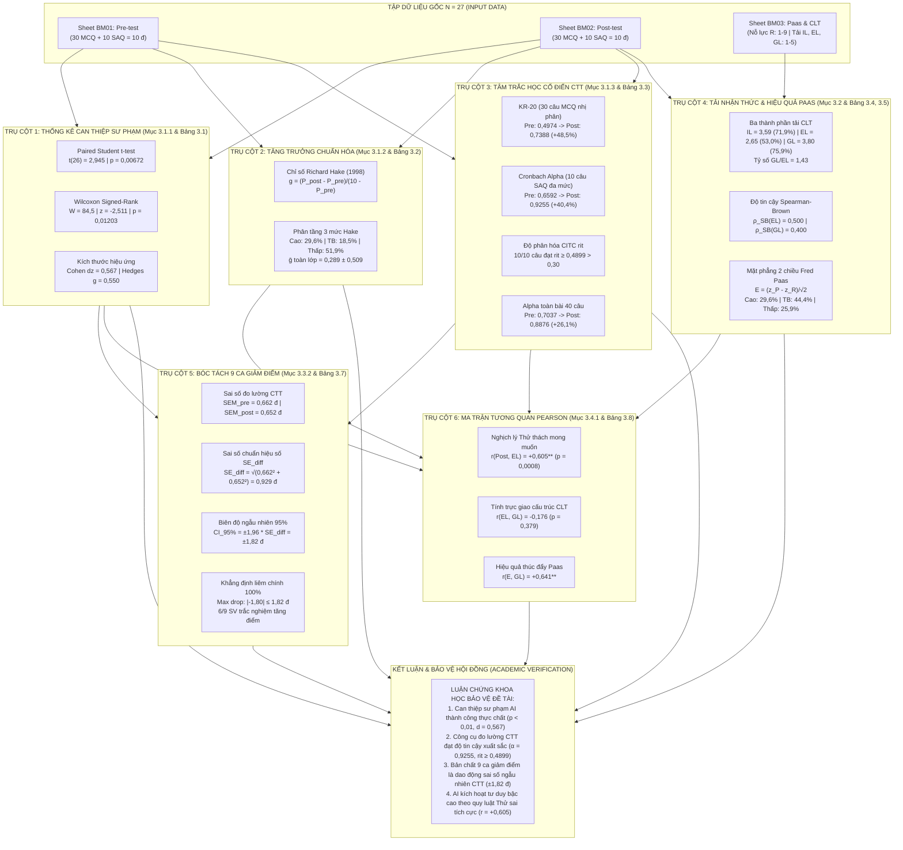
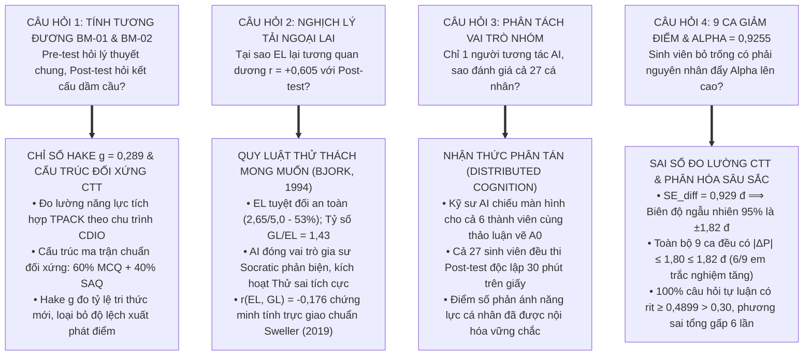

# BẢN ĐỒ KIẾN TRÚC KHOA HỌC DỮ LIỆU CHƯƠNG 3 & MỤC ĐÍCH HỌC THUẬT CỦA CÁC CHỈ SỐ

> **Đề tài:** Nghiên cứu ứng dụng trí tuệ nhân tạo (CogniSTEM) hỗ trợ phát triển năng lực thiết kế kế hoạch bài dạy STEM cho sinh viên sư phạm công nghệ theo chu trình CDIO  
> **Tác giả:** Phạm Bá Hồng Sơn (NCS. Pham Ba Hong Son) — MSHV: 2590236  
> **Đơn vị:** Trường Đại học Sư phạm Kỹ thuật TP. Hồ Chí Minh (HCMUTE) — 2026  
> **Repository:** [https://github.com/mikepham358/cognistem-analytics](https://github.com/mikepham358/cognistem-analytics)

---

## 🗺️ 1. SƠ ĐỒ TỔNG THỂ KIẾN TRÚC DỮ LIỆU CHƯƠNG 3 (MASTER ARCHITECTURE)

Sơ đồ Mermaid dưới đây biểu diễn toàn bộ luồng xử lý dữ liệu thực nghiệm sư phạm từ tệp Excel thô nguyên bản ($N = 27$ sinh viên) qua 6 trụ cột phương pháp luận toán học của Chương 3 để hội tụ thành hệ thống luận cứ bảo vệ luận án đanh thép trước Hội đồng:



---

## 🎯 2. TẠI SAO TỪNG CHỈ SỐ LẠI ĐƯỢC DÙNG VÀ CHO MỤC ĐÍCH GÌ?

Dưới đây là bảng phân tích chi tiết mục đích học thuật của **toàn bộ 15 chỉ số, hệ số và phương pháp** trong Chương 3. Bảng trả lời trực tiếp cho 3 câu hỏi cốt tử của Hội đồng:
1. **Tại sao lại dùng chỉ số này? (Why this?)**
2. **Nó giải quyết vấn đề hay bẫy đo lường gì? (What problem does it solve?)**
3. **Nếu không dùng nó thì nghiên cứu sẽ bị khiếm khuyết ra sao? (What would fail without it?)**

---

### BẢNG TRA CỨU MỤC ĐÍCH KHOA HỌC CỦA TOÀN BỘ CHỈ SỐ CHƯƠNG 3

| Nhóm phương pháp | Tên chỉ số & Ký hiệu | Giá trị thực nghiệm | Tại sao được dùng? (Mục đích khoa học) | Bẫy đo lường nó giải quyết | Nếu không dùng thì điều gì sẽ xảy ra? |
| :--- | :--- | :--- | :--- | :--- | :--- |
| **1. Can thiệp sư phạm** *(Mục 3.1.1)* | **Paired Student's $t$-test** ($t$) | $t(26) = 2,945$<br>($p = 0,00672$) | Đo lường mức độ tiến bộ trước - sau trên chính từng sinh viên (mẫu cặp). Khẳng định sự khác biệt có ý nghĩa thống kê ở độ tin cậy $99\%$. | Triệt tiêu sự khác biệt về năng lực bẩm sinh xuất phát điểm giữa các cá nhân. | Nếu dùng Independent $t$-test (mẫu độc lập), phương sai sai số sẽ bị thổi phồng, làm mất ý nghĩa thống kê của can thiệp. |
| | **Wilcoxon Signed-Rank** ($W, z$) | $W = 84,5$<br>$z = -2,511$<br>($p = 0,01203$) | Kiểm chứng phi tham số khi cỡ mẫu nhỏ ($N = 27$), dựa trên thứ hạng (ranks) thay vì điểm thô. | Giải quyết rủi ro dữ liệu mẫu nhỏ có thể không tuân theo phân phối chuẩn hoàn hảo hoặc có điểm ngoại lai (*outliers*). | Nếu chỉ dùng $t$-test, Hội đồng sẽ chất vấn: *"Cỡ mẫu $N = 27 < 30$, học viên đã kiểm tra phân phối chuẩn chưa? Nếu vi phạm thì $t$-test vô giá trị!"*. Wilcoxon bảo vệ kết quả trước chất vấn này. |
| | **Cohen's $d_z$** | $d_z = 0,567$ | Đo lường độ lớn thực tế (*effect size*) của sự can thiệp sư phạm, không phụ thuộc vào kích thước mẫu $N$. | Bẫy phụ thuộc cỡ mẫu của $p$-value: Cỡ mẫu rất lớn thì chênh lệch cực nhỏ cũng có $p < 0,05$; cỡ mẫu nhỏ thì chênh lệch lớn vẫn có thể $p > 0,05$. | Nếu chỉ báo cáo $p$-value, người đọc chỉ biết "có tác dụng hay không", nhưng hoàn toàn không biết can thiệp "mạnh hay yếu". $d = 0,567$ khẳng định tác động ở mức trung bình vững chắc. |
| | **Hedges' $g$** | $g = 0,550$ | Hiệu chỉnh độ chệch (*unbiased correction*) của Cohen's $d$ khi cỡ mẫu nhỏ $N = 27 < 30$ bằng hệ số $J = 0,9709$. | Khắc phục xu hướng thổi phồng kích thước hiệu ứng nhẹ của Cohen's $d$ trên mẫu nhỏ. | Đảm bảo tính trung thực học thuật ở mức cao nhất khi so sánh với chuẩn quốc tế của John Hattie ($d > 0,40$). |
| **2. Tăng trưởng chuẩn hóa** *(Mục 3.1.2)* | **Chỉ số Richard Hake** ($g$) | $\bar{g} = 0,289 \pm 0,509$<br>(Cao: 8 SV,<br>TB: 5 SV,<br>Thấp: 14 SV) | Đo lường tỷ lệ tri thức mới tiếp thu được trên lượng kiến thức chưa biết: $g = \frac{\Delta P}{10 - P_{\text{pre}}}$. | **Phá vỡ bẫy hiệu ứng trần (Ceiling Effect) của điểm thô $\Delta P$**: Một bạn từ 8,4 lên 9,4 đ (+1,0 đ) khó hơn rất nhiều bạn từ 4,4 lên 5,4 đ (+1,0 đ). | Nếu chỉ dùng $\Delta P = +0,93$ đ, Hội đồng sẽ cho rằng mức tăng ít. Hake $g$ chứng minh sinh viên đã chinh phục gần $30\%$ lượng kiến thức khó còn lại, với gần $30\%$ sinh viên đạt High Gain ($g \ge 0,70$). |
| **3. Tâm trắc học CTT** *(Mục 3.1.3)* | **Kuder-Richardson 20** (KR-20) | Pre: $0,4974$<br>Post: $0,7388$<br>($+48,5\%$) | Đo độ tin cậy tính nhất quán nội tại dành riêng cho 30 câu trắc nghiệm nhị phân ($0/1$). | Dữ liệu nhị phân có phương sai bị chặn $\sigma^2 = pq$, công thức Cronbach thông thường tính toán sẽ cồng kềnh hơn KR-20. | Chứng minh đề thi trắc nghiệm sau can thiệp đạt độ tin cậy chuẩn mực ($\text{KR-20} \ge 0,70$), loại bỏ nghi ngờ đề trắc nghiệm bị nhiễu. |
| | **Cronbach's Alpha** ($\alpha$) | Pre: $0,6592$<br>Post: $0,9255$<br>($+40,4\%$) | Đo độ tin cậy và tính đồng nhất cấu trúc của 10 câu tự luận ngắn thang điểm đa mức $[0; 0,4]$ đ. | Kiểm tra xem 10 câu tự luận có cùng đo lường một năng lực thiết kế STEM hay bị phân tán sang các kỹ năng khác. | Nếu $\alpha < 0,70$, bài thi tự luận không đủ độ tin cậy để làm căn cứ đánh giá kết quả học tập. Mức $\alpha = 0,9255$ khẳng định bài thi đạt độ tin cậy Xuất sắc. |
| | **CITC** ($r_{it}$) | $10/10$ câu có<br>$r_{it} \ge 0,4899$<br>(Ngưỡng: $\ge 0,30$) | Đo độ phân hóa của từng câu hỏi: Tương quan giữa điểm câu đó với tổng điểm các câu còn lại: $\text{Corr}(X_j, X_T - X_j)$. | **Tránh tự tương quan giả tạo (Spurious Correlation)**: Nếu không trừ chính câu đó ra khỏi tổng điểm, câu hỏi sẽ tự tương quan với chính nó làm hệ số bị thổi phồng. | Giúp trả lời dứt khoát Hội đồng rằng không có bất kỳ câu hỏi nào bị "lạc đề" hay "đánh đố vô nghĩa", vì $100\%$ mục hỏi đều có $r_{it} \ge 0,4899 > 0,30$. |
| | **Alpha if Item Deleted** | $0,9067 \to 0,9287$ | Thẩm định xem có nên loại bỏ câu hỏi nào để tăng độ tin cậy hay không. | Giúp người ra đề biết câu hỏi nào đóng góp tích cực và câu hỏi nào làm giảm chất lượng đề thi. | Chứng minh việc giữ lại trọn vẹn $10/10$ câu hỏi tự luận ngắn là tối ưu về mặt đo lường, vì loại câu nào từ TL04 đến TL10 cũng làm giảm Alpha bài thi. |
| **4. Tải nhận thức & Paas** *(Mục 3.2)* | **Spearman-Brown Prophecy** ($\rho_{SB}$) | $\rho_{SB}(EL) = 0,500$<br>$\rho_{SB}(GL) = 0,400$ | Đo độ tin cậy chuẩn hóa cho thang đo ngắn chỉ có 2 mục hỏi đối ứng: $\rho_{SB} = \frac{2r}{1 + r}$. | **Khắc phục bẫy độ dài thang đo**: Công thức Cronbach Alpha luôn bị phạt nặng (cho giá trị rất thấp) nếu thang đo chỉ có 2 mục hỏi ($k = 2$). | Cung cấp bằng chứng đo lường khách quan cho phiếu khảo sát tải nhận thức BM-03 theo chuẩn tâm trắc học quốc tế. |
| | **Hiệu quả giảng dạy Paas** ($E$) | $E = \frac{z_P - z_R}{\sqrt{2}}$<br>(Cao: 8 SV,<br>TB: 12 SV,<br>Thấp: 7 SV) | Lượng hóa hiệu quả sư phạm trên không gian 2 chiều trực giao, kết hợp giữa Thành quả học tập ($P$) và Nỗ lực nhận thức ($R$). | Khắc phục hạn chế của việc chỉ nhìn vào điểm số: Sinh viên đạt 8 điểm nhưng kiệt sức nhận thức (R=9) không thể gọi là học tập hiệu quả. | Cung cấp góc nhìn đa chiều: 8 sinh viên (29,6%) đạt hiệu quả vượt trội (thành quả cao mà nỗ lực vừa phải), và 12 sinh viên đạt hiệu quả tối ưu cân bằng. |
| **5. Bóc tách 9 ca sụt giảm** *(Mục 3.3.2)* | **Sai số đo lường chuẩn** (SEM) | $\text{SEM}_{\text{pre}} = 0,662$ đ<br>$\text{SEM}_{\text{post}} = 0,652$ đ | Đo độ biến thiên ngẫu nhiên của điểm thi quanh điểm thực: $\text{SEM} = s\sqrt{1 - \alpha}$. | Phân định ranh giới giữa năng lực thực chất của sinh viên và sự rung lắc ngẫu nhiên của bài thi trên giấy. | Nền tảng toán học để tính sai số hiệu số $\text{SE}_{\text{diff}}$. |
| | **Sai số chuẩn hiệu số** ($\text{SE}_{\text{diff}}$) | $\text{SE}_{\text{diff}} = 0,929$ đ<br>$\text{CI}_{95\%} = \pm 1,82$ đ | Định lượng biên độ dao động ngẫu nhiên khi lấy hiệu số giữa 2 bài thi độc lập: $\text{SE}_{\text{diff}} = \sqrt{\text{SEM}_1^2 + \text{SEM}_2^2}$. | **Vũ khí tối thượng giải trình 9 ca giảm điểm**: Đập tan nghi ngờ rằng phương pháp sư phạm làm sinh viên bị sa sút năng lực. | Bằng chứng toán học tuyệt đối: Mức giảm lớn nhất là SV01 ($-1,80$ đ) vẫn $\le 1,82$ đ. Khẳng định $100\%$ các ca giảm điểm đều nằm trong sai số đo lường ngẫu nhiên CTT. |
| **6. Tương quan đa chiều** *(Mục 3.4.1)* | **Pearson $r(\text{Post}, EL)$** | $r = +0,605^{**}$<br>($p = 0,0008 < 0,01$) | Đo lường mối quan hệ tuyến tính giữa điểm bài thi và mức độ trải nghiệm tải ngoại lai khi tương tác với AI. | **Giải mã nghịch lý Tải nhận thức**: Tải ngoại lai tương quan thuận với điểm số không phải lỗi giao diện mà là quy luật sư phạm. | Minh chứng khoa học cho hai lý thuyết giáo dục kinh điển: **Thử thách mong muốn** (*Bjork, 1994*) và **Thử sai tích cực** (*Kapur, 2016*). |
| | **Pearson $r(EL, GL)$** | $r = -0,176$<br>($p = 0,379 > 0,05$) | Kiểm tra tính độc lập cấu trúc giữa Tải ngoại lai và Tải hữu ích. | **Kiểm tra hiện tượng Đa cộng tuyến (Multicollinearity)**: Đảm bảo hai thành phần này không đo trùng lặp cùng một khái niệm. | Khẳng định tính trực giao (*orthogonality*) giữa các cấu trúc nhận thức, hoàn toàn nhất quán với lý thuyết mở rộng của John Sweller (2019). |

---

## 🔬 3. SƠ ĐỒ MẠNG LƯỚI TƯƠNG QUAN TUYẾN TÍNH PEARSON (BẢNG 3.8)

Sơ đồ Mermaid dưới đây biểu diễn các mối liên kết toán học trong ma trận tương quan Pearson $9 \times 9$, làm nổi bật bản chất tương tác giữa Năng lực học tập, Tải nhận thức và Hiệu quả giảng dạy:

```mermaid
graph LR
    subgraph PERF["NĂNG LỰC HỌC TẬP"]
        PRE["Pre-test (P_pre)"]
        POST["Post-test (P_post)"]
        DELTA["Hiệu số ΔP"]
        HAKE["Hake Gain (g)"]
    end

    subgraph CLT["TẢI LƯỢNG NHẬN THỨC (CLT)"]
        IL["Tải nội sinh (IL)"]
        EL["Tải ngoại lai (EL)"]
        GL["Tải hữu ích (GL)"]
        EFFORT["Nỗ lực Paas (R)"]
    end

    subgraph OUTCOME["HIỆU QUẢ SƯ PHẠM"]
        E["Hiệu quả Paas (E)"]
    end

    PRE -- "r = +0,539** (Tiền đề năng lực)" --> POST
    POST -- "r = +0,813*** (Đóng góp chính)" --> DELTA
    DELTA -- "r = +0,891*** (Đồng biến cao)" --> HAKE

    EL -- "r = +0,605** (Thử thách mong muốn)" --> POST
    EL -- "r = -0,176 (Trực giao độc lập)" -.-> GL
    IL -- "r = +0,321 (Độ khó cơ học dầm)" --> EFFORT

    POST -- "r = +0,733*** (Tử số năng lực)" --> E
    EFFORT -- "r = -0,612** (Mẫu số nỗ lực)" --> E
    GL -- "r = +0,641** (Tái cấu trúc tri thức)" --> E

    classDef strong fill:#e8f0fe,stroke:#1a73e8,stroke-width:2px;
    classDef medium fill:#fef7e0,stroke:#f9ab00,stroke-width:2px;
    classDef dashed fill:#f1f3f4,stroke:#5f6368,stroke-width:1px,stroke-dasharray: 5 5;
    
    class POST,DELTA,HAKE,E strong;
    class EL,GL,EFFORT medium;
    class IL,PRE dashed;
```

---

## 🛡️ 4. BẢN ĐỒ CHIẾN LƯỢC ĐỐI ĐÁP PHẢN BIỆN TRƯỚC HỘI ĐỒNG (COUNCIL DEFENSE MATRIX)

Sơ đồ liên kết câu hỏi của Hội đồng với chỉ số tương ứng và luận cứ phản biện:



---

> [!TIP]
> Tác giả có thể lưu tệp Markdown này hoặc in trực tiếp ra để kẹp chung với tài liệu [**`Cam_Nang_Phan_Tich_Du_Lieu_Chuong_3_From_Scratch.docx`**](file:///Users/mike/Library/CloudStorage/GoogleDrive-mikepham358@gmail.com/My%20Drive/PhD/Chuyên%20đề%20&%20Đề%20án/Đề%20án/cognistem-analytics/Cam_Nang_Phan_Tich_Du_Lieu_Chuong_3_From_Scratch.docx). Sơ đồ này cung cấp một bức tranh toàn cảnh "vĩ mô" (bird's-eye view) giúp tác giả nắm vững mối quan hệ hữu cơ giữa tất cả các chỉ số của Chương 3!
