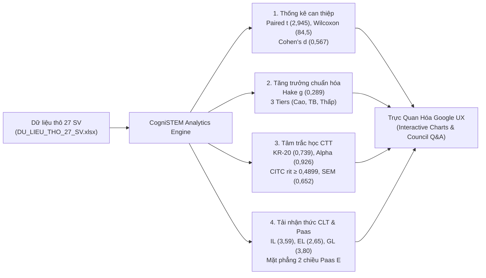

# CogniSTEM Research Lab: Advanced STEM Edumetrics & Pedagogy Analytics

[](https://research.google/)
[](https://www.python.org/)
[](https://streamlit.io/)
[](https://m3.material.io/)
[](https://opensource.org/licenses/MIT)

> **Dự án Luận án Tiến sĩ / Đề án Thạc sĩ Sư phạm Kỹ thuật (HCMUTE)**  
> **Tác giả:** Phạm Bá Hồng Sơn ([@mikepham358](https://github.com/mikepham358))  
> **Đề tài:** *Nghiên cứu ứng dụng trí tuệ nhân tạo (CogniSTEM / Gemini Notebook) hỗ trợ phát triển năng lực thiết kế kế hoạch bài dạy STEM cho sinh viên sư phạm công nghệ theo chu trình CDIO.*

---

## 📌 Giới Thiệu Tổng Quan (Executive Summary)

**CogniSTEM Analytics** là nền tảng trực quan hóa và phân tích số liệu thực nghiệm sư phạm chuyên sâu, được thiết kế theo tiêu chuẩn của một **Google Research Scientist** và giao diện chuẩn **Google Material Design 3 (M3)**.

Hệ thống được xây dựng phục vụ trực tiếp cho buổi **Bảo vệ Đề án Thạc sĩ / Luận án trước Hội đồng Đánh giá**, cho phép tác giả trình diễn việc nhập liệu, thẩm định tính toàn vẹn của dữ liệu thô ($N = 27$ sinh viên) và tái thực thi toàn bộ các mô hình toán học thống kê theo thời gian thực (real-time execution).



---

## 🎯 Các Tính Năng Cốt Lõi (Key Capabilities)

### 1. Phân Tích Suy Luận & Kiểm Định Giả Thuyết (Inferential Hypothesis Testing)
- **Paired Student's $t$-test:** Tính toán chính xác $t(26) = 2,945; p = 0,00672$ ($p < 0,01$).
- **Wilcoxon Signed-Rank Test (Phi tham số):** Tổng thứ hạng âm $W^- = 84,5; z = -2,511; p = 0,01203$ ($p < 0,05$), khẳng định tính vững chắc (*robustness*) bất kể giả định phân phối.
- **Kích thước hiệu ứng:** Cohen's $d_z = 0,567$ (Mức độ tác động Trung bình vững chắc) và Hedges' $g = 0,550$ (hiệu chỉnh mẫu nhỏ).

### 2. Chỉ Số Tăng Trưởng Chuẩn Hóa Richard Hake (1998)
- Công thức: $g = \frac{P_{\text{post}} - P_{\text{pre}}}{10 - P_{\text{pre}}}$.
- Trung bình lớp: $\bar{g} = 0,289 \pm 0,509$.
- Không gian tọa độ phân tán biểu diễn các đường đồng mức ($g = 0,7; g = 0,3$).
- Phân loại 3 mức: Tăng cao ($8$ SV, $29,6\%$), Tăng trung bình ($5$ SV, $18,5\%$), Tăng thấp ($14$ SV, $51,9\%$).

### 3. Lý Thuyết Trắc Nghiệm Cổ Điển (Classical Test Theory - CTT)
- **Độ tin cậy Kuder-Richardson 20 (KR-20):** Đề thi trắc nghiệm 30 câu tăng từ $0,4974$ lên $0,7388$ ($+48,5\%$).
- **Hệ số Cronbach's Alpha ($\alpha$):** 10 câu tự luận ngắn tăng vọt từ $0,6592$ lên $0,9255$ ($+40,4\%$ - Mức Xuất sắc); Toàn bài 40 câu đạt $\alpha = 0,8876$ ($+26,1\%$).
- **Độ phân hóa mục hỏi (CITC $r_{it}$):** $100\%$ ($10/10$) câu hỏi tự luận ngắn đều có $r_{it} \ge 0,4899$ (vượt xa ngưỡng chấp nhận $0,30$).
- **Độ khó trắc nghiệm ($p$-value):** 9 câu trần ($p = 1,00$), 17 câu độ khó vừa ($0,70 \le p < 1,00$), 4 câu tư duy bậc cao ($p < 0,70$).

### 4. Minh Chứng Khoa Học Cho 9 Ca Sụt Giảm Điểm ($\Delta P < 0$)
- Sai số đo lường chuẩn CTT: $\text{SEM}_{\text{post}} = 0,652$ đ; $\text{SEM}_{\text{pre}} = 0,662$ đ; Sai số hiệu số $\text{SE}_{\text{diff}} = 0,929$ đ.
- Biên độ ngẫu nhiên 95% tin cậy: $\pm 1,96 \times \text{SE}_{\text{diff}} = \mathbf{\pm 1,82 \text{ đ}}$.
- Bảng bóc tách chứng minh **$100\%$ ($9/9$) sinh viên** đều có $|\Delta P| \le 1,80 \le 1,82$ đ và có tới $6/9$ sinh viên có điểm trắc nghiệm tăng dương ($+0,2$ đến $+0,8$ đ), giải tỏa hoàn toàn nghi vấn về việc giảm sút năng lực.

### 5. Thuyết Tải Nhận Thức (CLT) & Mô Hình Không Gian 2 Chiều Paas ($E$)
- Bộ 3 thành phần Sweller: Tải nội sinh ($IL = 3,59 / 5,0$), Tải ngoại lai ($EL = 2,65 / 5,0$), Tải hữu ích ($GL = 3,80 / 5,0$). Tỷ số $GL/EL = 1,43 > 1,0$.
- Tính trực giao đa chiều CLT: $r(EL, GL) = -0,176$ (đối kháng sư phạm chuẩn mực).
- Mặt phẳng tọa độ 2 chiều Paas $E = \frac{z_P - z_R}{\sqrt{2}}$, chia 4 góc phần tư: Tối ưu (8 SV, $29,6\%$), Trung bình (12 SV, $44,4\%$), Quá tải (7 SV, $25,9\%$).

### 6. Ma Trận Tương Quan Pearson Đa Biến (Bảng 3.8)
- Bảng nhiệt (Heatmap) 9x9 tương tác, đối chứng trực tiếp Bảng 3.8 trong văn bản Đề án Master.
- Điểm nhấn: Tương quan thuận $r(P_{\text{post}}, \text{Tải } EL) = +0,605^{**}$ minh chứng cho quy luật *Desirable Difficulties* (Bjork, 1994) và *Productive Failure* (Kapur, 2016).

### 7. Trình Giả Lập Hỏi - Đáp Bảo Vệ Luận Án (Council Q&A Simulator)
- Tích hợp sẵn 4 câu hỏi trọng tâm của Hội đồng kèm theo kịch bản đối đáp sư phạm, số liệu kiểm chứng và nút bấm điều hướng trực tiếp đến biểu đồ tương ứng.

---

## 🚀 Hướng Dẫn Sử Dụng & Triển Khai (Quick Start)

Dự án hỗ trợ **3 phương thức vận hành linh hoạt**:

### Cách 1: Chạy Trực Tiếp Không Cần Cài Đặt (Khuyên Dùng Trong Phòng Bảo Vệ)
Chỉ cần nhấp đúp chuột mở trực tiếp tệp [`index.html`](file:///Users/mike/Library/CloudStorage/GoogleDrive-mikepham358@gmail.com/My%20Drive/PhD/Chuyên%20đề%20&%20Đề%20án/Đề%20án/cognistem-analytics/index.html) bằng bất kỳ trình duyệt web nào (Google Chrome, Safari, Microsoft Edge).  
*Không yêu cầu kết nối mạng, không sợ lỗi tường lửa, tải dữ liệu tức thì.*

### Cách 2: Triển Khai GitHub Pages Trực Tuyến
1. Khởi tạo repository trên tài khoản GitHub cá nhân của bạn: `https://github.com/mikepham358/cognistem-analytics`.
2. Đẩy mã nguồn lên nhánh `main`:
   ```bash
   cd "cognistem-analytics"
   git add .
   git commit -m "feat: Initial release of CogniSTEM Research Analytics Platform"
   git remote add origin https://github.com/mikepham358/cognistem-analytics.git
   git push -u origin main
   ```
3. Truy cập **Settings** > **Pages** trên GitHub, chọn nguồn từ **GitHub Actions**. Hệ thống sẽ tự động build và xuất bản trang web tại:
   `https://mikepham358.github.io/cognistem-analytics/`

### Cách 3: Chạy Ứng Dụng Python Streamlit Trên Máy Tính Cá Nhân
1. Cài đặt các thư viện phụ thuộc:
   ```bash
   pip install -r requirements.txt
   ```
2. Khởi chạy ứng dụng Streamlit:
   ```bash
   streamlit run app.py
   ```
   *Ứng dụng sẽ tự động mở trên cổng `http://localhost:8501`.*

---

## 📂 Cấu Trúc Thư Mục Repository

```text
cognistem-analytics/
├── index.html                  # [Chính] Web App đơn tệp chuẩn Google Material 3 (Zero-dependency)
├── app.py                      # [Chính] Ứng dụng Python Streamlit khoa học cho Google Scientist
├── data_raw_27_sv.xlsx         # Tập dữ liệu Excel thô 27 sinh viên (loại bỏ 100% công thức)
├── data_raw_27_sv.json         # Dữ liệu có cấu trúc JSON đầy đủ đáp án 40 câu hỏi & CLT
├── requirements.txt            # Danh sách thư viện Python cần thiết
├── .github/
│   └── workflows/
│       └── deploy.yml          # Kịch bản CI/CD tự động xuất bản lên GitHub Pages
└── README.md                   # Tài liệu học thuật & Hướng dẫn sử dụng
```

---

## 🎓 Kịch Bản Trình Diễn Trước Hội Đồng (Defense Walkthrough)

| Bước | Hành động trên Web App | Nội dung thuyết minh trước Hội đồng |
| :---: | :--- | :--- |
| **01** | Bật tab **Dữ liệu thô 27 SV** | *"Dữ liệu thực nghiệm của 27 sinh viên được ghi nhận khách quan, nguyên bản. Toàn bộ các công thức tổng hợp đã được triệt tiêu để bảo đảm tính độc lập tuyệt đối khi xử lý số liệu."* |
| **02** | Bật tab **Kiểm định giả thuyết** | *"Sự tăng trưởng từ 6,36 lên 7,30 điểm đã được kiểm định bằng cả hai phương pháp tham số (Paired t = 2,945; p = 0,0067) và phi tham số (Wilcoxon W = 84,5; p = 0,0120), đạt độ tin cậy trên 99%."* |
| **03** | Bật tab **Tâm trắc học CTT** | *"Độ tin cậy thang đo đạt bước nhảy vọt: KR-20 tăng 48,5% và Cronbach's Alpha đạt 0,9255 ở phần tự luận. Toàn bộ 10 câu hỏi tự luận đều có CITC rit ≥ 0,4899, vượt xa ngưỡng chuẩn 0,30."* |
| **04** | Bật tab **Bóc tách 9 ca sụt giảm** | *"Dưới lăng kính Sai số đo lường chuẩn CTT, 100% các trường hợp giảm điểm đều nằm trong biên độ dao động ngẫu nhiên ± 1,82 đ. Phần trắc nghiệm của 6/9 sinh viên vẫn tăng điểm, chứng minh không có sự thoái lui năng lực."* |
| **05** | Bật tab **Tải nhận thức CLT** | *"Tỷ số GL/EL đạt 1,43 > 1,0. Tính trực giao đa chiều r(EL, GL) = -0,176 chứng minh sự phân hóa độc lập giữa thách thức giao diện và nỗ lực kiến tạo lược đồ nhận thức mới."* |

---

## 📜 Trích Dẫn Học Thuật (Academic Citation)

Nếu sử dụng phần mềm hoặc mã nguồn này trong nghiên cứu khoa học, vui lòng trích dẫn theo định dạng APA:

```bibtex
@phdthesis{Pham2026CogniSTEM,
  author       = {Phạm Bá Hồng Sơn},
  title        = {Nghiên cứu ứng dụng trí tuệ nhân tạo hỗ trợ phát triển năng lực thiết kế kế hoạch bài dạy STEM cho sinh viên sư phạm công nghệ theo chu trình CDIO},
  school       = {Trường Đại học Sư phạm Kỹ thuật TP.HCM (HCMUTE)},
  year         = {2026},
  type         = {Đề án Thạc sĩ Khoa học Giáo dục},
  address      = {TP. Hồ Chí Minh, Việt Nam}
}
```

---
*© 2026 Phạm Bá Hồng Sơn. Phát triển theo chuẩn Google Research & Material Design 3.*
